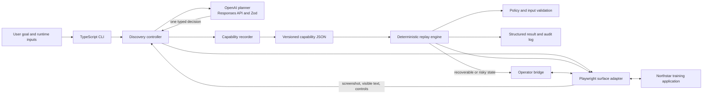
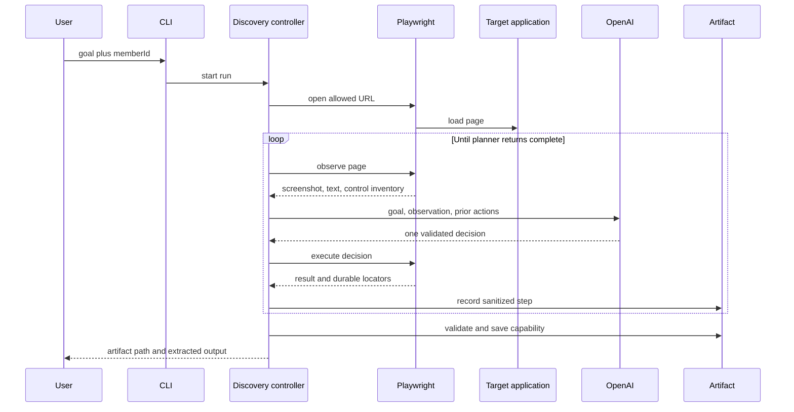
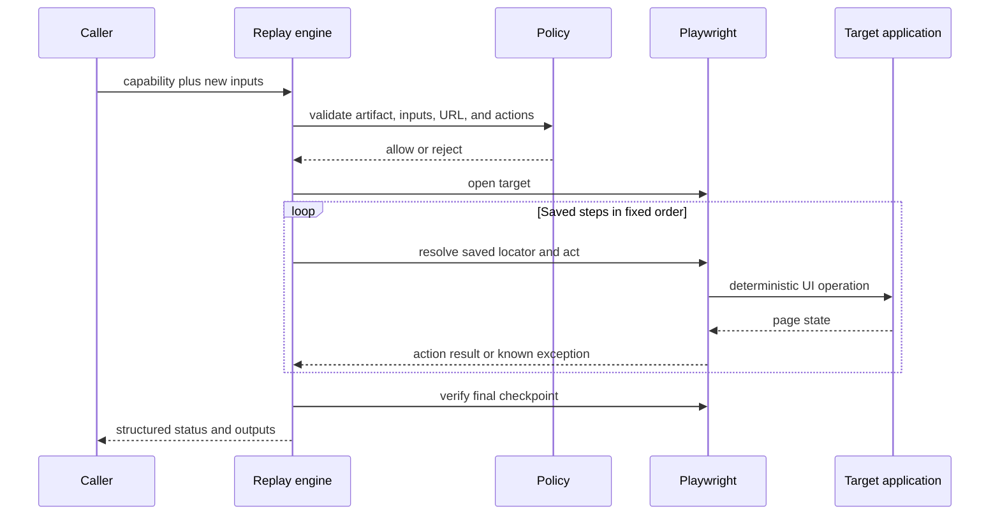

# Computer-Use Automation System

A record-once, replay-many computer-use automation prototype for the Interface.ai take-home assignment.

The system accepts a natural-language goal, lets an OpenAI model discover the workflow against a live browser application, records the successful actions as a typed capability artifact, and replays that artifact deterministically with Playwright. The language model is used during discovery only. Normal replay makes no model call.

The included Northstar application is a local, synthetic proxy for a legacy member-servicing system. It supports successful balance lookup, member-not-found, permission-denied, session-expiry, and same-session human handoff scenarios.

## What is implemented

| Requirement | Implementation |
| --- | --- |
| Natural-language discovery | OpenAI Responses API planner returns one schema-validated action per turn |
| Computer use | Playwright observes and operates the live web page |
| Reusable capability | Versioned JSON artifact with inputs, outputs, steps, locators, policy, exceptions, and provenance |
| Deterministic replay | Fixed Playwright executor with no LLM in the replay path |
| Error classification | Business outcomes, recoverable exceptions, and hard failures have distinct structured results |
| Human handoff | Local operator console controls the original browser page and then returns ownership to automation |
| Safety | Origin, path, action, input, and risk checks are enforced outside the model |
| Evidence | Offline reproducible evidence plus a script for genuine OpenAI discovery evidence |

## Architecture



The implementation uses a custom single-agent discovery loop. It does not use the OpenAI Agents SDK, a multi-agent framework, or OpenAI's built-in computer-use tool. The `OpenAIPlanner` is the agent: it receives the goal and current observation and chooses one constrained action. Playwright owns all browser interaction, and the policy layer remains authoritative.

See [docs/ARCHITECTURE.md](docs/ARCHITECTURE.md) for the full internal flow, design choices, schemas, and handoff model.

## How discovery works



During recording, runtime values are replaced with templates such as `{{memberId}}`. Extracted data is not retained in target locators. The resulting artifact is a reviewed execution plan, not a raw model transcript.

## How replay works



Replay never asks the model what to do. It resolves `{{memberId}}`, follows the saved steps, tries saved locator strategies in order, classifies known target states, verifies the success checkpoint, and returns structured JSON.

## Technology choices

| Technology | Role |
| --- | --- |
| TypeScript on Node.js | Entire implementation, CLI, target server, and tests |
| OpenAI JavaScript SDK | Responses API call during discovery |
| Zod | Structured model output and capability validation |
| Playwright | Browser observation, interaction, screenshots, and replay |
| Node test runner | Unit and integration tests |

## Repository map

```text
src/
  agent/             OpenAI planner, discovery loop, planner contract
  core/              Schemas, templates, policy, logging, redaction
  handoff/           Same-session operator bridge and local console
  replay/            Deterministic capability executor
  surface/           Playwright surface adapter
  target/            Synthetic Northstar training application
  cli.ts             discover and replay commands
scripts/              Offline and live evidence generators
tests/                Unit and integration tests
artifacts/            Manually generated capability artifacts
evidence/             Checked-in evidence and evidence instructions
docs/                 Architecture and evaluator demo guide
REPORT.md             Required seven-section design report
SUBMISSION_CHECKLIST.md Final publication checklist
```

## Prerequisites

- Node.js 20 or newer
- npm
- An OpenAI API key for live discovery
- Windows PowerShell, macOS Terminal, or a Linux shell

## Quick start on Windows PowerShell

PowerShell may block `npm.ps1`. The commands below intentionally use `npm.cmd` and `npx.cmd`, which do not require changing the system execution policy.

From the project directory:

```powershell
git clone https://github.com/YOUR-USERNAME/YOUR-REPOSITORY.git
cd YOUR-REPOSITORY
npm.cmd install
npx.cmd playwright install chromium
```

Run the tests:

```powershell
npm.cmd test
```

The expected summary is eight passing tests and zero failures.

## Five-minute evaluator demo

Detailed steps and expected results are in [docs/DEMO_GUIDE.md](docs/DEMO_GUIDE.md).

### 1. Start the target in terminal 1

```powershell
npm.cmd run target
```

The application is available at `http://127.0.0.1:4173/app`.

### 2. Run genuine OpenAI discovery in terminal 2

Set the key only in the current terminal. Do not save or commit it.

```powershell
$env:OPENAI_API_KEY = "your-key"
$env:OPENAI_MODEL = "gpt-5.4-mini"
npm.cmd run discover -- --goal "Look up member 10001 and return the current savings balance" --member-id 10001 --artifact artifacts/lookup-savings.generated.json --headed
```

The visible browser shows the model-guided discovery. A successful run prints an artifact path and an output similar to:

```json
{
  "outputs": {
    "savingsBalance": "$4,281.17"
  }
}
```

The exact value is synthetic target data. The saved artifact records the workflow and `{{memberId}}` template, not the runtime member number or balance.

### 3. Replay with a different input and no LLM

```powershell
npm.cmd run replay -- --artifact artifacts/lookup-savings.generated.json --member-id 10002 --headed
```

Expected status: `success`. Expected synthetic balance: `$915.40`.

### 4. Show classified outcomes

Legitimate business outcome:

```powershell
npm.cmd run replay -- --artifact artifacts/lookup-savings.generated.json --member-id 40404
```

Expected status: `business_outcome`. Expected code: `MEMBER_NOT_FOUND`.

Hard failure:

```powershell
npm.cmd run replay -- --artifact artifacts/lookup-savings.generated.json --member-id 90000
```

Expected status: `failure`. Expected code: `PERMISSION_DENIED`.

### 5. Show same-session human handoff

```powershell
npm.cmd run replay -- --artifact evidence/example-capability.json --member-id 10001 --url "http://127.0.0.1:4173/app?scenario=session-timeout-once" --operator --headed
```

Replay pauses and prints a local operator-console URL. Open it, choose **Take control**, click **Return to sign in** in the screenshot, and choose **Resume automation**. The operator acts on the same Playwright page and browser context. Replay retries the interrupted step and completes.

### 6. Stop the target

In terminal 1, press `Ctrl+C`. If `netstat -ano | findstr :4173` shows only `TIME_WAIT`, `FIN_WAIT_2`, or `CLOSE_WAIT` entries and no `LISTENING` entry, the server is already stopped.

## Evidence generation

Repeatable offline evidence needs no API key:

```powershell
npm.cmd run evidence:offline
```

The offline generator uses a scripted planner for CI and reviewer repeatability. Its provenance is explicit, and it is not presented as the required LLM discovery.

The checked-in final package includes genuine OpenAI discovery evidence generated with `gpt-5.4-mini`. To regenerate it, stop any separately running target server first, then run:

```powershell
$env:OPENAI_API_KEY = "your-key"
$env:OPENAI_MODEL = "gpt-5.4-mini"
npm.cmd run evidence:live
```

This command manages its own target server and writes the live capability, discovery log, replay logs, results, and screenshots under `evidence/`. Review those files before publishing.

## macOS and Linux command equivalents

Use `npm` instead of `npm.cmd` and `npx` instead of `npx.cmd`. For example:

```bash
npm install
npx playwright install chromium
export OPENAI_API_KEY="your-key"
npm run target
```

All discover and replay arguments remain the same.

## Configuration

The default discovery model is `gpt-5.4-mini`, selected for lower latency while retaining image input, Responses API, and Structured Outputs support. Override it only with a compatible model:

```powershell
$env:OPENAI_MODEL = "gpt-5.4-mini"
```

`.env.example` is a reference only. The project does not automatically load `.env`, which avoids silently reading secrets from disk.

## Training scenarios

| Member number | Expected behavior |
| --- | --- |
| `10001` | Successful lookup for Alex Morgan, balance `$4,281.17` |
| `10002` | Successful replay with different data, balance `$915.40` |
| `40404` | `MEMBER_NOT_FOUND` business outcome |
| `80000` | Session-expiry condition |
| `90000` | `PERMISSION_DENIED` hard failure |

## Safety and privacy

- Exact origin and path allowlists are checked before and after replay actions.
- Artifact policy allowlists action kinds.
- Steps marked `risky` require human control when approval is enabled.
- Runtime inputs are validated and parameterized rather than persisted.
- Sensitive keys, bearer tokens, runtime inputs, and extracted outputs are redacted from JSONL logs.
- Output values are not retained as text locators.
- OpenAI requests set `store: false`.
- The included data is synthetic. Real screenshots would still require encryption, access controls, retention limits, and approved provider handling.
- The operator console binds to localhost and is intentionally not production-ready or network-safe.

## Troubleshooting

### `npm.ps1 cannot be loaded because running scripts is disabled`

Use `npm.cmd` and `npx.cmd`, as shown in this README. No execution-policy change is required.

### `browserType.launch: Executable doesn't exist`

Install the project browser binary:

```powershell
npx.cmd playwright install chromium
```

### Port 4173 is already in use

Stop the terminal running `npm.cmd run target` with `Ctrl+C`. To find a remaining listener:

```powershell
netstat -ano | findstr LISTENING | findstr :4173
```

If a listener is shown, stop only that confirmed process ID with `Stop-Process -Id 12345`, replacing `12345` with the displayed ID.

### The model is unavailable

Set `OPENAI_MODEL` to an accessible model that supports the project's structured output request, then rerun discovery. Replay does not need an API key or model access.

### Discovery succeeds but replay fails

Confirm that the target server is running at the artifact's allowed origin, that the input has exactly five digits, and that the artifact was generated against the current target version. Inspect the structured error and screenshot path printed by replay.

## Submission documents

- [REPORT.md](REPORT.md): concise report with the seven required headings
- [docs/ARCHITECTURE.md](docs/ARCHITECTURE.md): detailed approach and diagrams
- [docs/DEMO_GUIDE.md](docs/DEMO_GUIDE.md): exact evaluator reproduction commands
- [evidence/README.md](evidence/README.md): evidence provenance and generation
- [SUBMISSION_CHECKLIST.md](SUBMISSION_CHECKLIST.md): final checks, publication, and submission sequence

## Known scope cuts

This is a focused prototype, not a production banking integration. It implements one Playwright web adapter and one synthetic target. It does not include a distributed queue, authenticated operator service, database-backed capability catalog, artifact signing, tenant deployment infrastructure, or real customer data. These cuts are documented in [REPORT.md](REPORT.md).
