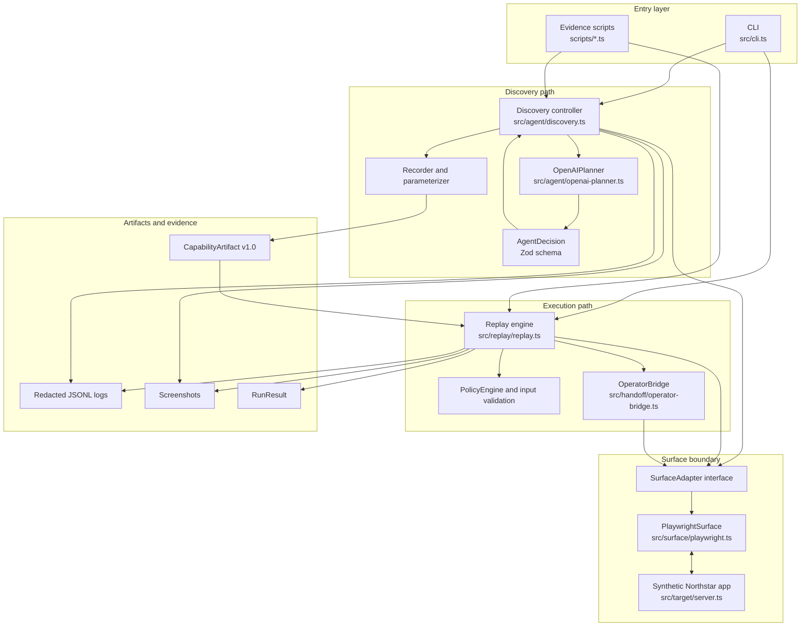
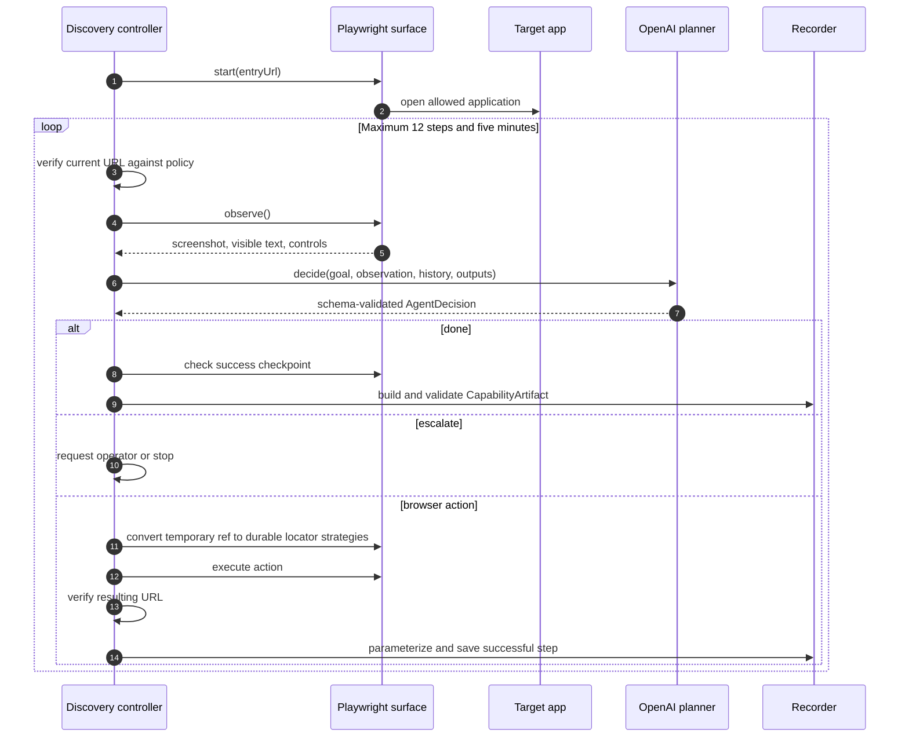
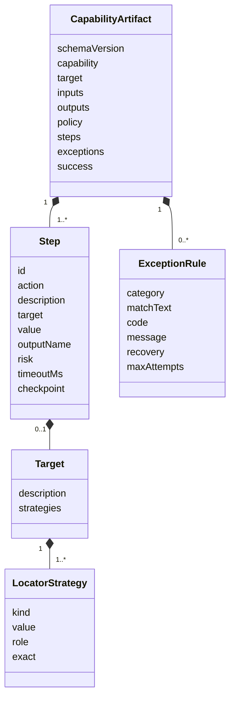
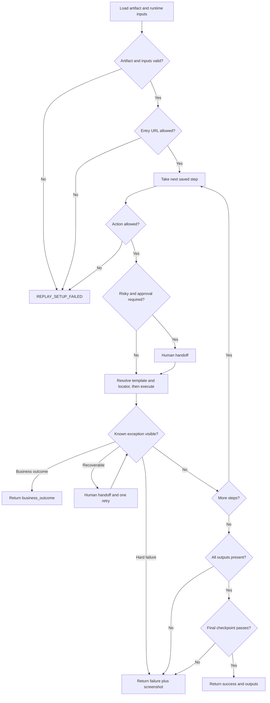
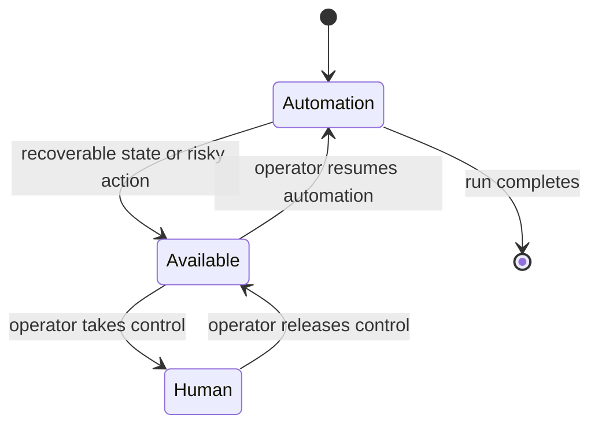

# Architecture and Implementation Approach

## 1. Problem framing

Many back-office workflows still live behind user interfaces instead of stable APIs. A fully model-driven agent can navigate these interfaces, but using a model for every production invocation adds latency, cost, nondeterminism, and a larger safety surface. A static Playwright script is predictable, but it requires an engineer to understand and encode every workflow.

This project combines both approaches:

1. Use an OpenAI model once to discover a workflow against a live application.
2. Convert the successful actions into a validated, inspectable capability artifact.
3. Replay that artifact with deterministic Playwright code and no model decision-making.
4. Stop or transfer control to a human when policy or a known runtime condition requires it.

The implementation is deliberately small enough to inspect end to end.

## 2. Component architecture



### Component responsibilities

| Component | Responsibility | Explicitly does not do |
| --- | --- | --- |
| CLI | Parse commands, build dependencies, print structured output | Decide browser actions |
| OpenAI planner | Select one action from the current observation | Execute browser code or bypass policy |
| Discovery controller | Run the observe, decide, execute, record loop | Persist a raw transcript as the capability |
| Surface adapter | Observe the current UI, resolve locators, perform actions | Decide the business goal |
| Capability artifact | Define the complete reusable execution contract | Contain credentials or runtime member values |
| Replay engine | Validate, execute fixed steps, classify results, verify success | Call an LLM to repair or reinterpret a step |
| Policy engine | Enforce allowed locations, actions, and approval rules | Trust a model decision by default |
| Operator bridge | Transfer control over the original browser session | Create a separate replacement session |
| Logger | Write structured audit events with redaction | Treat screenshots as automatically safe |

## 3. Agent design

The word agent in this repository means the `OpenAIPlanner` class. It is a custom, single-agent loop built with the OpenAI JavaScript SDK. The project does not use the OpenAI Agents SDK, an orchestration framework, or the built-in OpenAI computer-use tool.

For each discovery turn, the planner receives:

- the natural-language goal;
- the current URL and page title;
- visible page text;
- a compact inventory of controls with temporary references;
- a low-detail screenshot;
- previously completed actions;
- declared output names; and
- names of outputs already extracted.

The Responses API returns an `AgentDecision` validated by Zod:

```text
action: navigate | fill | click | extract | done | escalate
targetRef: temporary reference to a currently visible control, or null
value: input or navigation value, or null
outputName: declared output name for extraction, or null
reason: short action explanation
confidence: 0 through 1
risk: safe | risky
completed: boolean
requestHuman: boolean
```

Only one action is permitted per turn. The model cannot inject JavaScript or arbitrary Playwright selectors. It must select a control reference from the current observation. The controller and adapter then validate and execute the action.

## 4. Discovery flow



### Observation

`PlaywrightSurface.observe` captures a screenshot, visible text, URL, title, and a compact list of interactive controls. Temporary references reduce the planner's action space and prevent it from inventing a selector.

### Action execution

The adapter maps the chosen temporary reference to stable strategies such as:

1. associated label;
2. accessible role and name;
3. placeholder;
4. stable attributes expressed as CSS; and
5. visible text as a fallback.

Those strategies are ordered and saved so replay can try them deterministically.

### Recording and sanitization

The recorder keeps successful actions only. An input equal to a runtime input becomes a template such as `{{memberId}}`. Input values mentioned in action descriptions become the same template. Extracted values are not saved as action values, descriptions, accessible names, or text selectors.

The model can occasionally use a reasonable output alias. If exactly one output is declared, the controller safely normalizes that alias to the declared output name and logs the normalization. With multiple outputs, an undeclared name fails discovery because guessing would be ambiguous.

### Completion

The planner cannot complete merely by returning `done). The controller also requires every declared output to exist and the final checkpoint to pass. Only then is the capability artifact validated and written.

## 5. Capability artifact

The versioned artifact is both an execution plan and a calling contract.



Important fields include:

- discovery provider, model, and run ID for provenance;
- target application, vendor, version, tenant variant, and base URL;
- typed input and output declarations;
- allowed origins, paths, and actions;
- a fixed ordered step list;
- explicit exception classification and recovery; and
- a final success checkpoint.

The checked-in [offline example capability](../evidence/example-capability.json) demonstrates the complete schema. Running `npm.cmd run evidence:live` creates `evidence/live-capability.json` with genuine OpenAI provenance.

## 6. Deterministic replay flow



Replay makes no call to `OpenAIPlanner`. It uses only the artifact, caller inputs, policy, surface adapter, and optional operator bridge. This split makes replay faster, cheaper, auditable, and repeatable.

The structured result contains:

- `success`, `business_outcome`, `failure`, or `escalated`;
- a stable result code;
- outputs produced before completion;
- the failed step, expected state, and observed state when relevant;
- evidence paths; and
- start and finish timestamps.

## 7. Exception model

| Category | Example | Result | Recovery |
| --- | --- | --- | --- |
| Business outcome | Member does not exist | `business_outcome / MEMBER_NOT_FOUND` | None, caller consumes the answer |
| Recoverable | Session expired | Human handoff, then retry | One retry of the interrupted step |
| Hard failure | Permission denied | `failure / PERMISSION_DENIED` | None |
| Execution failure | Locator cannot resolve | `failure / STEP_EXECUTION_FAILED` | Evidence screenshot |
| Contract failure | Output missing | `failure / MISSING_OUTPUT` | Evidence screenshot |

The separation matters because a valid negative business result is not a software crash.

## 8. Human handoff



The bridge has an explicit control owner. While intervention is active, automation waits. The operator console shows a current screenshot and forwards only allowlisted actions to the original Playwright page. It does not open a new browser session. Operator text is logged as a redacted character count. When the operator resumes, control returns to automation and replay continues in the same run.

The demo console is bound to localhost and has no authentication. This is suitable for demonstrating the control-transfer seam, not for network exposure.

## 9. Safety boundaries

Safety controls are enforced outside the model:

- input schemas reject malformed runtime values before interaction;
- origin and path allowlists are checked before launch, during discovery, and around replay actions;
- action kinds must appear in the artifact policy;
- risky steps can require human approval;
- model output must pass Zod validation;
- the model can act only through current control references;
- discovery has step and wall-clock limits;
- final outputs and success state are independently verified;
- logs redact sensitive names, runtime values, authorization values, and extracted output values; and
- OpenAI requests use `store: false`.

Screenshots are still potentially sensitive. A production design would add encryption, access control, retention limits, tenant isolation, and an approved provider data-handling configuration.

## 10. Heterogeneity and multi-tenant extension

`SurfaceAdapter` is the portability seam. The current implementation is `PlaywrightSurface`, but another adapter could implement the same methods for:

- Windows UI Automation;
- an accessibility tree;
- OCR plus screenshot coordinates; or
- a remote desktop protocol.

The artifact separates vendor workflow identity from tenant variant. A production catalog could store one reviewed base capability plus narrow variant overlays for routes, locators, and known dialogs. A preflight fingerprint could compare application title, landmarks, and version text before selecting a compatible artifact. Unknown fingerprints should block unattended execution.

## 11. Design tradeoffs

### Why not use the model during replay?

The assignment's central value is turning a discovered workflow into a repeatable capability. Removing the model from replay gives a clear determinism boundary and makes failures reproducible.

### Why save multiple locator strategies?

One selector is brittle. Ordered semantic and attribute strategies tolerate small markup variations without introducing model-based recovery.

### Why keep discovery and replay in one process?

Interfaces already separate the responsibilities. Queues and services would add deployment complexity without proving the core design more clearly.

### Why use a synthetic target?

It makes the submission self-contained and safe to evaluate. Known data and fault scenarios provide deterministic evidence without connecting to a real banking system.

## 12. Scope cuts

The prototype intentionally omits distributed scheduling, persistent catalog storage, authenticated operator sessions, artifact signing, live bank integrations, and tenant deployment infrastructure. It implements only a web adapter. These are productization tasks, while this repository focuses on discovery, artifact generation, deterministic replay, safety checks, error classification, and control transfer.
